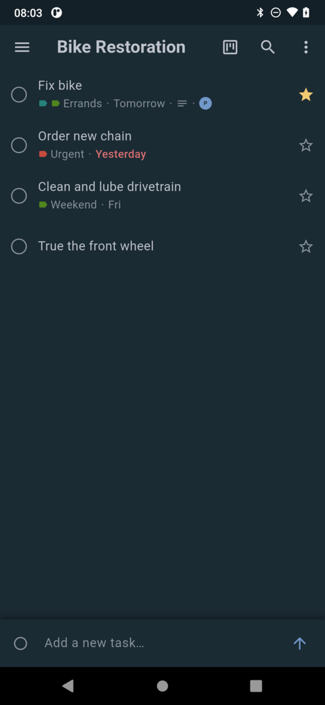
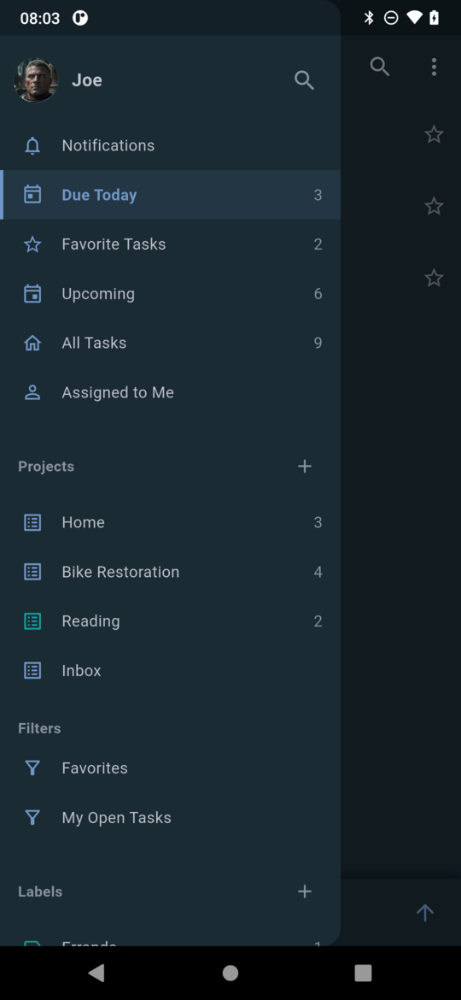
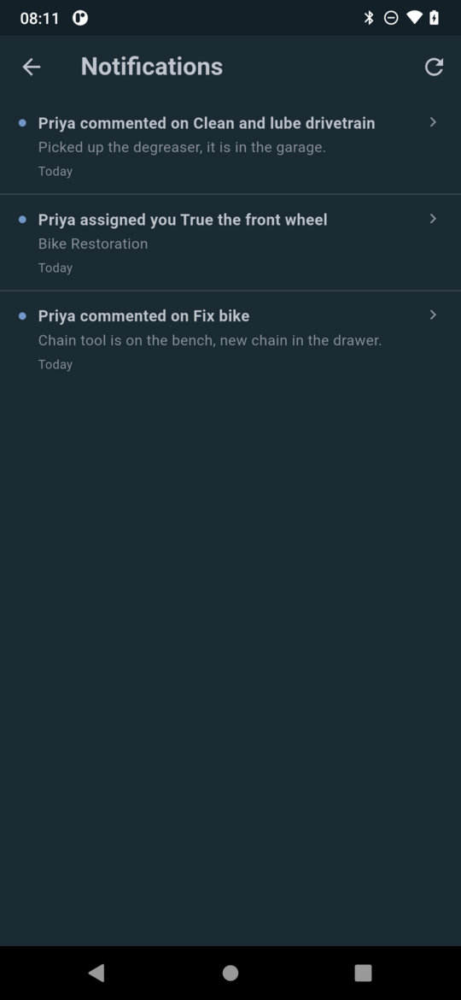
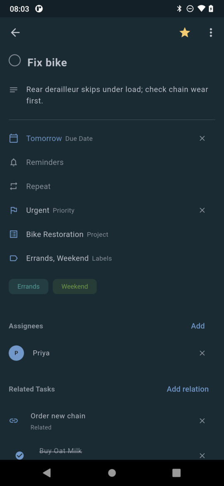
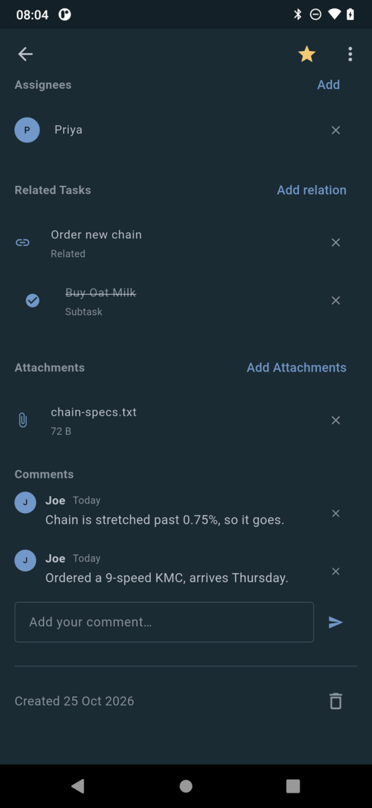
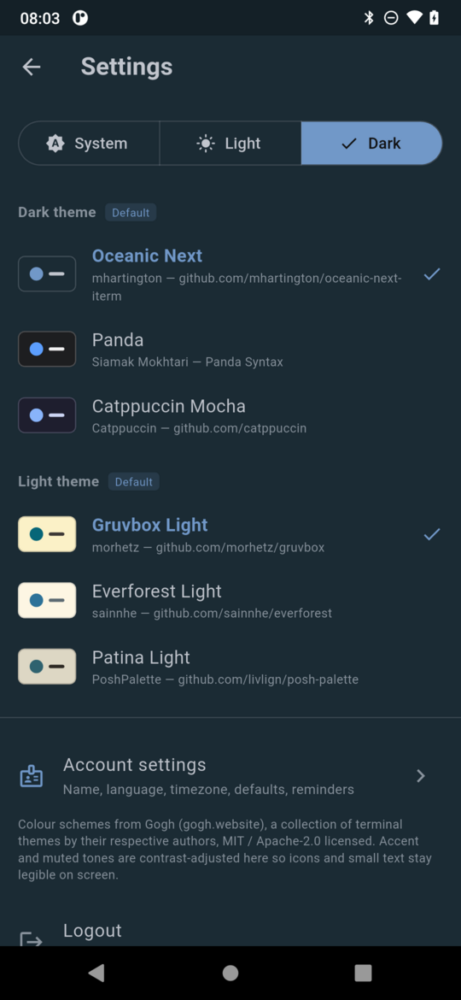
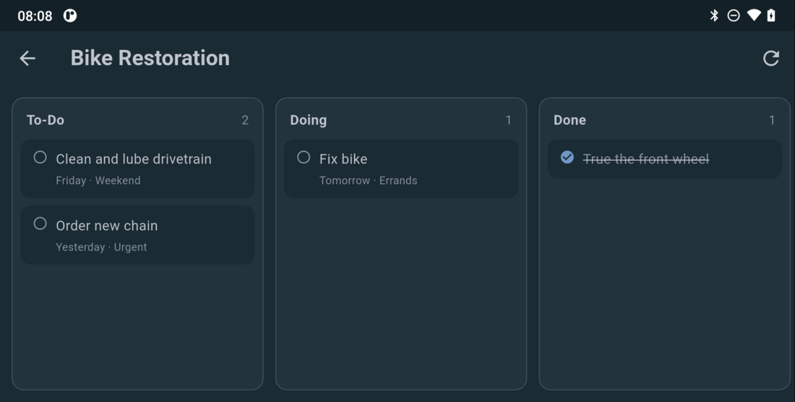
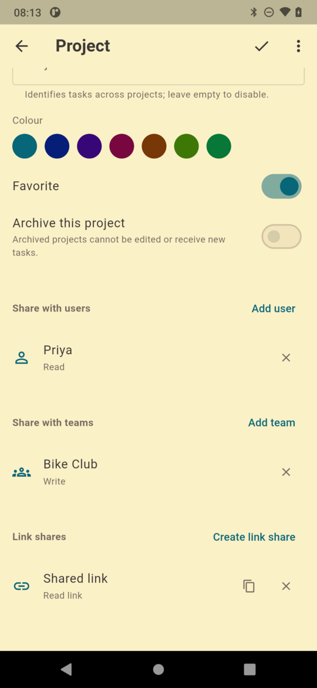
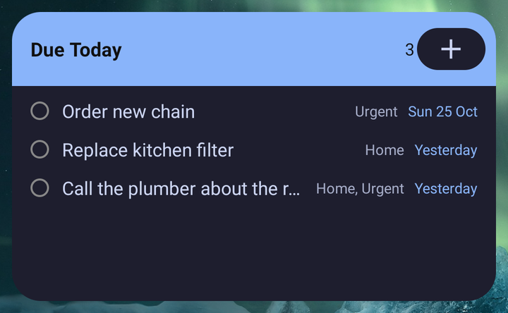
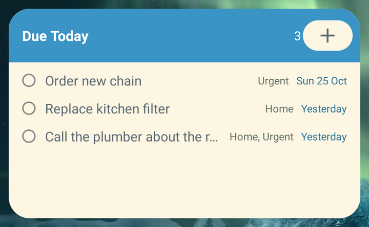

  

<h1 align="center">Sloth</h1>

  Your Vikunja tasks on Android, in a calm list-first app.

  <a href="https://github.com/kurobeats/sloth/releases/latest">Download</a> ·
  <a href="#install">Install</a> ·
  <a href="#screenshots">Screenshots</a> ·
  <a href="#what-you-can-do">Features</a> ·
  <a href="#themes">Themes</a>

---

Sloth talks to your own [Vikunja](https://vikunja.io) server and puts the day in
front of you: what is due, what is overdue, and a single bar to add the next
thing. It is a list-first app — a drawer of smart lists, projects, filters and
labels; flat task rows with a round check target; nothing to configure before
you can use it.

Everything stays between your phone and your server. There is no account to
create here, no analytics, and no Sloth service in the middle.

## Screenshots

  
  
  

  
  
  

  

  

  
  

Those two are the same widget with a different scheme picked in the app.

## What you can do

**Get through the day.** Due Today, Upcoming, All Tasks, Assigned to Me and your
favourites are all one tap from the drawer, with a Done section that folds away.
Pull down to refresh. The add-a-task bar is always at the bottom.

**Work on a task.** Open one to set its title, description, due date, reminders,
repeat, priority, project and labels; add assignees, subtasks and other related
tasks, comments, and file attachments you can download or share.

**See the whole board.** Every project can be shown as a Kanban board — columns
come from the project's own board view, and dragging a card moves it there for
real.

**Share the way Vikunja does.** Invite people or teams to a project, choose
read / write / admin, create password-protected link shares, and copy the link
straight to your clipboard.

**Find things.** Search across tasks; saved filters from Vikunja appear in the
drawer as read-only lists.

Wording follows Vikunja's own interface, so "Labels", "Upcoming" and "Due Today"
mean the same thing here as they do in the web UI.

## Notifications and the home screen widget

Vikunja has no push service, so Sloth checks for notifications while it is
running — on launch, on refresh, and every ten minutes in the foreground — and
posts a status-bar notification for new assignments, comments, mentions and team
changes. Tapping one opens the task. Nothing arrives while the app is closed.

The home screen widget mirrors your Due Today list: up to five rows, each with
the task title, its labels and Vikunja's own wording for when it is due, with
overdue rows in the accent colour. Tap a row to open that task, or the header to
open the app. It repaints in whichever theme you have picked.

## Offline

The last successful refresh is kept as a read-only copy on the device, so the app
opens with your tasks instead of an empty screen when the network is gone, with a
banner saying how old that copy is. Editing needs a connection — the add-a-task
bar disables itself and every edit tells you why.

## Your session

You stay signed in. On first login Sloth asks your server for a long-lived access
token instead of relying on the short-lived login token, keeps it in the phone's
secure store, and renews it on the next login. If you ever want to cut a device
off, delete the token named **Sloth** in Vikunja under *Settings → API Tokens* —
no password change needed.

Servers with a private certificate authority (Caddy's internal CA, for example)
work too: tick **Allow self-signed certificate** on the login screen. Trust is
remembered per server and applies to that host only. Plain `http://` is refused
for remote servers, because it would send your password in the clear.

## Themes

Six colour schemes from [Gogh](https://gogh.website) (MIT / Apache-2.0), with
their original names and authors:

| Theme | Author | Mode |
|---|---|---|
| Oceanic Next | mhartington | dark, default |
| Panda | Siamak Mokhtari | dark |
| Catppuccin Mocha | [Catppuccin](https://github.com/catppuccin) | dark |
| Gruvbox Light | morhetz | light, default |
| Everforest Light | sainnhe | light |
| Patina Light | PoshPalette | light |

Pick one dark and one light scheme in **Settings**, plus follow-system, light or
dark mode. Gogh palettes are tuned for terminal text, so the app nudges accent
and muted colours until they stay readable; every colour in the interface comes
from the theme you chose. Label colours are the only exception — those belong to
your server.

## Install

Grab the newest APK from [Releases](https://github.com/kurobeats/sloth/releases):
`app-arm64-v8a-release.apk` suits any phone from roughly the last seven years,
`armeabi-v7a` is for older 32-bit devices, `x86_64` for emulators. Android will
ask you to allow installing from your browser or file manager the first time.

To have Sloth update itself, use [Obtainium](https://github.com/ImranR98/Obtainium):

1. Install Obtainium (its own releases page has the APK).
2. **Add App** → paste `https://github.com/kurobeats/sloth` → **Add**.
3. Use the latest release; pick the arm64-v8a APK when asked.
4. From then on, update from inside Obtainium. Sloth has no store listing and no
   update check of its own.

Updates install straight over the old version and keep your settings.

## Known limits

- Only list and Kanban views; Vikunja's table and Gantt views are not drawn.
- Offline is read-only — there is no queue of edits waiting to sync.
- No push notifications and no background work: alerts and the widget update
  while the app is running.
- Repeating tasks follow whatever Vikunja decides a completed occurrence becomes;
  individual occurrences are not edited here.
- Android only. The code is Flutter and would build for iOS, but nobody has done
  it — there is no iPhone build today.

## License

GPL-3.0-or-later. See [LICENSE](LICENSE).
